# 17 · 参考界面逐项对照

> 本文回答：**参考图片里画了什么，我们做到哪一步，哪些没做、为什么。**
>
> - 参考图来源：`refs/dsh-claude-style/docs/screenshots/`（第三方项目 `dsh-claude-style`，
>   MIT，Claude Code Desktop 主题的复刻）。共 8 张，本文逐项对照 **4 张 claude-***：
>   `claude-home-light`、`claude-conversation-light`、`claude-home-dark`、`claude-conversation-dark`。
>   另 4 张是同一界面的 DeepSeek 配色变体，布局与本文结论一致，不重复分析。
> - 这些图**不随本仓库分发**：它们属于第三方项目的品牌物料，只在本机 `refs/` 下用于取色与对照。
>   本文只记录**我观察到的事实**与我们的**实现对应**，不复制图片。
> - **我们自己的截图随仓库分发**：`docs/screenshots/harness/`（17 张，1440×900 为主，含深色与
>   900px 窄窗口各一张）。它们是用 `docs/screenshots/seed-demo.sh` + `capture.mjs` 从**真实运行的
>   服务**里抓的，每个状态都有 DOM 断言；生成方式与"哪些内容是构造的"见
>   [`screenshots/README.md`](screenshots/README.md)。下文每一节都给出一一对应的我们的画面。
> - 品牌边界见 `docs/design/DESIGN.md` §零：取设计语言，不取品牌标识。
>
> **配套**：每项功能的入口与行为 → [`15-FEATURES.md`](15-FEATURES.md)；
> 模块划分 / 依赖 / 数据流 → [`16-ARCHITECTURE-DETAIL.md`](16-ARCHITECTURE-DETAIL.md)。
>
> 状态标记：**✅ 采用**（行为与视觉都有）、**🔶 改做**（目的相同、形态不同）、
> **⛔ 未采用**（并给出理由，不是遗漏）。

---

## 零、对照索引

参考图 ↔ 我们的截图，一张对一张（或一对多）：

| 参考图（外部） | 我们的画面（仓库内） | 对照结论 |
|---|---|---|
| `claude-home-light.png` 首页 · 浅色 | [`harness-02-home-light.png`](screenshots/harness/harness-02-home-light.png)（工作区 + 事件流顶部） [`harness-16-chat-light.png`](screenshots/harness/harness-16-chat-light.png)（对话线） | 三栏骨架、品牌行、新对话芯片、分组标题、相对时间、composer 芯片行 **✅**；项目目录树、首页统计卡、吉祥物 **⛔**（见 §五） |
| `claude-conversation-light.png` 对话 · 浅色 | [`harness-03-conversation-light.png`](screenshots/harness/harness-03-conversation-light.png) | 顶栏标题 + 状态、页签、消息块、过程行、工具卡配对/合并、就地审批卡、Markdown、状态栏 **✅**；代码语法高亮与语言标签 **⛔** |
| `claude-home-dark.png` 首页 · 深色 | [`harness-15-conversation-dark.png`](screenshots/harness/harness-15-conversation-dark.png)（深色同一运行） | 近黑画布、边框作高光、首帧前应用主题 **✅** |
| `claude-conversation-dark.png` 对话 · 深色 | 同上 | 层级靠"亮一档"表达，无硬编码颜色 **✅** |
| （参考产品没有） | [`harness-04-usage-light.png`](screenshots/harness/harness-04-usage-light.png) · [`05`](screenshots/harness/harness-05-workbench-files.png) · [`06`](screenshots/harness/harness-06-workbench-diff.png) · [`07`](screenshots/harness/harness-07-workbench-diff-file.png) · [`08`](screenshots/harness/harness-08-workbench-terminal.png) · [`09`](screenshots/harness/harness-09-subagents.png) · [`10`](screenshots/harness/harness-10-browser-session.png) · [`11`](screenshots/harness/harness-11-browser-f12.png) · [`12`](screenshots/harness/harness-12-system-ready.png) · [`13`](screenshots/harness/harness-13-system-capabilities.png) · [`14`](screenshots/harness/harness-14-palette.png) · [`17`](screenshots/harness/harness-17-narrow-900.png) | 本仓库多出来的部分，见 §六 |

---

## 一、`claude-home-light.png`（首页 · 浅色）

**我们的同一画面**：

> 左栏「工作区」分组下是「对话」1 条与置顶的运行；中栏顶部是本轮边界与计划；下方是 composer。
> 对照参考图的差异见下表最后几行（无首页统计卡、无项目树、无吉祥物）。

| 图片中的内容 | 我们的实现 | 状态 |
|---|---|---|
| 左侧栏约 19% 宽，中间主区约 81% | 侧栏 `--w-sidebar: 280px`，可折叠到 56px；主区 `minmax(0,1fr)` | ✅ |
| 左上角品牌：星形图标 + 衬线「Claude」 | `BrandMark` 双环标记 + 衬线字标「artex」（`web/src/Sidebar.jsx` `rail-brand`）。**星芒是 Anthropic 品牌标识，换成自有标记** | 🔶 |
| 品牌行右侧一个方框图标（切换侧栏） | `命令面板`（⌘K）与 `收起侧栏` 两个 `PanelLeftClose` 图标 | ✅ |
| 「+ 新会话」（圆形加号芯片 + 整行） | `new-row`：`plus-chip` 圆形加号 + 「新对话」，整行可点 | ✅ |
| 「插件」（菱形图标） | **没有这一项**。我们的插件/MCP 管理在 `设置 → 插件 · MCP`，不占侧栏一级入口 | 🔶 |
| 分组标题「工作区」+ 右侧两个小图标（滑块、加号） | `group-head`「工作区」+ 右侧 `筛选`（SlidersHorizontal）与 `新建任务`（FilePlus） | ✅ |
| 项目子分组「demo-project」，其下若干行 | **没有项目分组层**。侧栏是按状态分组的平铺列表，每行 = 一个对话或一个运行。项目目录是**单个运行**的属性（工作台 → 项目页），不是侧栏的树 | ⛔ |
| 每行右侧的相对时间（「19分钟」「1小时」） | 行尾 `date-fns` `formatDistanceToNowStrict` zhCN（「19 分钟」「1 小时」） | ✅ |
| 行文案形态「Claude · Fix flaky onboarding…」（工具名 + 摘要） | 行标题回落链 `name → goal → description → task#id`，**没有「工具名 ·」前缀** | 🔶 |
| 中间大标题「What's up next, Ada?」 | **没有首页/欢迎屏**。控制台打开就是工作区，未选任务时中栏显示空态文案 | ⛔ |
| 六张统计数字卡片（会话数 401 / 消息数 13,262 / Token 123.5M / 活跃天数 137 / 高峰时段 / 最常用模型） | **没有首页统计卡片**。用一个**用量热力图**（`HeatGrid`）回答"我这些天用了多少"，逐日按 UTC 聚合全部任务的 token；没有"高峰时段""最常用模型"两个衍生指标 | 🔶 |
| 输入框占位「How can I help you today?」 | 占位随状态变：「今天要我做什么？」/「先新建一个对话，或在左侧选择会话」 | 🔶 |
| 输入框上方两个控件「demo-project」「标准模式」 | composer 芯片行：项目名（`FolderClosed` + 目录尾名，无绑定则显示「工作区」）+ 「标准模式」（`ShieldCheck`） | ✅ |
| 输入框下方一行：`Read` `Edit`（选中）`Yolo` `+` `DeepSeek V4 Flash` `High` | 下方一行：`模型选择` · `思考深度` · `平台管控`（只读）· `插入文件` · `上下文占用 %` · `生成速度` · `发送`。**`Read/Edit/Yolo` 这类"工具白名单 + 自动执行强度"没有对应**——我们的等价物是审批规则（设置 → 权限与审批），不放在输入框上 | 🔶 |
| 右下角橙色像素吉祥物 | **没有吉祥物**。参考项目自己在 LICENSE 里写明形象归 Anthropic；我们用品牌标记 `artex-mark.png` | ⛔ |
| 暖米白纸面 + 单一赤陶强调色 | `--c-canvas: #fcfcfb`、`--c-accent: #d97757`，浅/深两套（实测值见 `web/src/tokens.css` 注释） | ✅ |

## 二、`claude-conversation-light.png`（对话 · 浅色）

**我们的同一画面**：

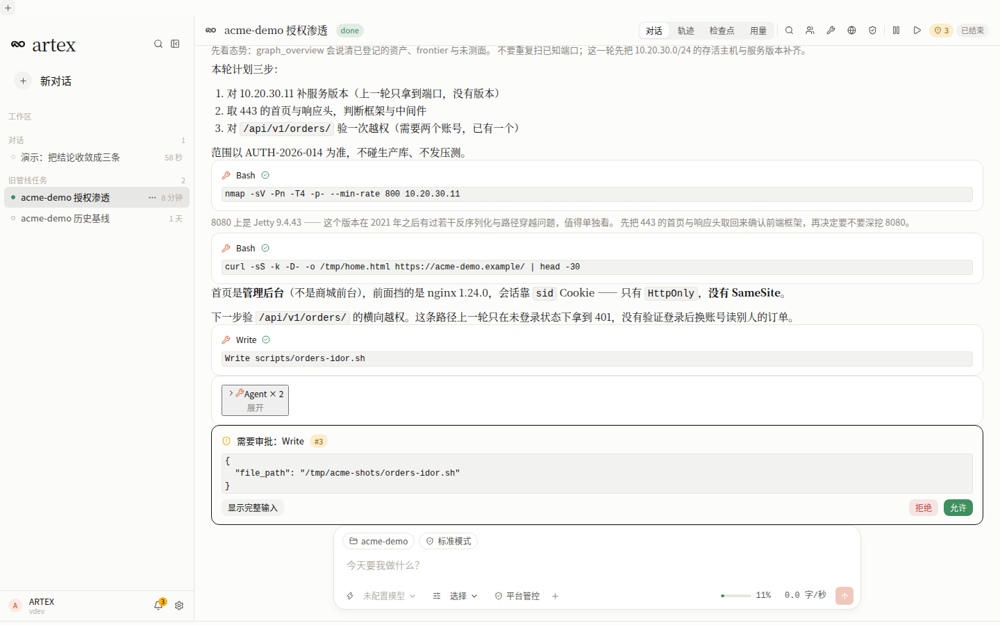

> 一轮里的思考块、连续 `Bash × N` 合并卡、`Write` 调用，以及**就地审批卡片**（拒绝 / 允许）。
> 参考图把审批做成全局档位，这里做成逐次卡片——这是 harness 的差异，不是缺失。

| 图片中的内容 | 我们的实现 | 状态 |
|---|---|---|
| 三区：左栏 / 中栏 / 顶栏；无右侧栏展开 | `.app` 网格：侧栏 + 主区（+ 右栏按需，互斥单一面板） | ✅ |
| 顶栏左：会话标题「Markdown rendering tour」 | 标题回落链 + 状态徽标（`created/running/done/…`，颜色 + 文字双信号） | ✅ |
| 顶栏左：齿轮图标 +「标准模式」 | 模式在 **composer 芯片行**而不是顶栏；顶栏放状态徽标。同一信息的两个位置，我们只保留一处，避免两处状态打架 | 🔶 |
| 顶栏中：「对话」「轨迹」切换（选中态底色更深） | `SegmentedView`：**对话 / 轨迹 / 检查点 / 用量** 四页签，`role="tablist"` + `aria-selected` | ✅（多两页） |
| 顶栏右：图标按钮组、`…` 更多、侧栏切换 | 搜索 · 子代理 · 工作台 · 浏览器 · 系统 · 暂停 / 恢复 · 审批徽标 | 🔶 |
| 左栏：品牌行、「新会话」、「插件」、「工作区」+ 两个小图标 | 同 §一（无「插件」项） | 🔶 |
| 左栏：`demo-project` 项目文件夹，其下 4 条会话，时间戳「20分钟 / 1小时 / 2小时」 | 平铺列表 + 状态分组 + 相对时间；无项目文件夹层 | ⛔ |
| 左栏：`notes-app` `theme-lab` `docs-site` `sample-app` 多个项目可折叠 | 同上，无项目树 | ⛔ |
| 左栏底部：头像 + 用户名 | `rail-foot`：头像（`账户与菜单`）+ 通知铃（带待审批数量徽标）+ 设置 | ✅ |
| 中栏第一块：用户消息，右对齐 | 用户消息块（`msg-wrap`），正文取自 `activity.detail` | ✅ |
| 中栏：「用时1秒」过程行，带展开箭头 | 思考块单独标注 + 轮次块头「步数 · 错误 · 令牌」+ 可折叠工具卡 | ✅ |
| 助手回复含 Markdown 示例（标题/粗体/列表/表格/行内代码/代码块） | `react-markdown` + `remark-gfm`；代码块带复制按钮 | ✅ |
| 代码块的语言标签 + 复制按钮 + 高亮 | 复制按钮 ✅；**语言标签没有**；**语法高亮没有**——`highlight.js` 主题与 `rehype-highlight` 插件在统一主题时都移除了（它们自带一套写死的浅色配色，深色模式下会与令牌打架），代码块现在只用 `--c-surface-2` + 令牌描边着色，靠字体与留白区分。要恢复高亮，需要一套**读 `data-theme` 的自有配色**，不能直接装回 GitHub 主题 | ⛔ |
| 工具调用卡片 / diff 视图 | 工具调用 ↔ 结果按 `tool_use_id` 配对成一张卡；连续同类合并成「Bash × 6」；DIFF 在工作台「DIFF」页（与基线对比的 unified diff） | ✅ |
| 底部输入框 + 下方控件行 | 同 §一 | ✅ |
| 最底部状态栏（时间/字数之类） | `.statusbar`：实时状态点 + 文案 · `#任务id` · `N 条事件` · `N 轮 · 压缩 N` | ✅（内容不同） |

## 三、`claude-home-dark.png`（首页 · 深色）

**我们的同一画面**：

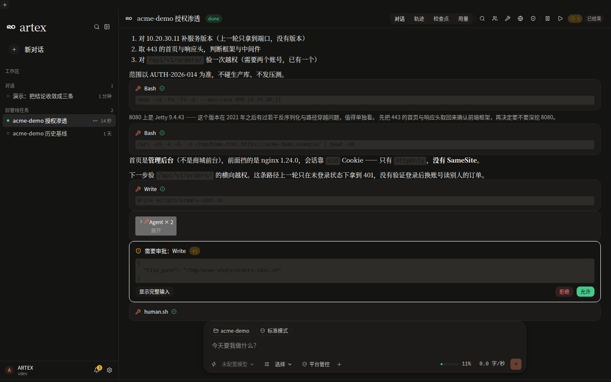

| 图片中的内容 | 我们的实现 | 状态 |
|---|---|---|
| 近黑画布（`#141413` 一类），不是纯黑 | `:root[data-theme="dark"]`：canvas `#141413`、raised `#1c1b1a`、hairline `#262626` | ✅ |
| 深色下边框画成"高光"而非勾边 | `--c-border-1: #262626`（比画布亮一档），注释里写明"dark edges are a highlight, not a contour" | ✅ |
| 布局、侧栏条目、统计卡片、输入区 | 同 §一（结构结论一致，只换配色） | ✅ |
| 切换方式 | 外观三档：亮 / 暗 / 跟随系统（`artex.appearance`），在**首帧前**应用 `data-theme`，避免先亮后翻 | ✅ |

## 四、`claude-conversation-dark.png`（对话 · 深色）

| 图片中的内容 | 我们的实现 | 状态 |
|---|---|---|
| 三区 + 顶栏 + 底部状态栏，深色下层级靠"亮一档"表达 | 同上；深色令牌独立一套，无硬编码颜色 | ✅ |
| 顶栏元素、切换按钮、左栏条目 | 同 §二 | 🔶 |
| 对话正文与输入区 | 同 §二 | ✅ |

---

## 五、汇总

| 类别 | 数量 | 项 |
|---|---|---|
| ✅ 采用 | 22 | 纸张画布与单一强调色、浅深两套令牌、侧栏折叠与品牌行、新对话芯片、分组标题与两个动作、相对时间、composer 芯片行（项目 + 标准模式）、四页签切换、用户/助手消息块、过程行与折叠、Markdown（表格/列表/行内代码/代码块 + 复制）、工具卡配对与合并、DIFF 视图、状态栏、头像与通知、深色"高光边框"、首帧主题应用 … |
| 🔶 改做 | 10 | 品牌标记换自有、插件入口移到设置、行文案无工具名前缀、首页统计换成用量热力图、占位文案中文化、工具白名单/自动执行强度改为审批规则、模式位置从顶栏移到 composer、顶栏按钮组按 harness 能力重排、状态栏内容改为运行观测 … |
| ⛔ 未采用 | 4 | **侧栏项目目录树**、**首页欢迎屏与六张统计卡片**、**吉祥物形象**、**代码块语法高亮**（连同语言标签） |

### 四个 ⛔ 项的理由（不是遗漏）

1. **侧栏项目目录树**：参考产品是"一个应用管理多个项目、每项目多个会话"。本项目的数据模型是
   **一个运行 = 一个工作区目录**（`tasks.project_dir`，且有互斥：一个目录同一时刻只归一个活任务）。
   把它做成树需要引入"项目"这一层实体并重做互斥语义，不是界面改动。当前折中：项目目录是运行的属性，
   在工作台「项目」页改绑，composer 芯片显示目录尾名。
2. **首页欢迎屏 + 六张统计卡片**：控制台打开即进入工作区（侧栏列表本身就是"最近在做什么"）。
   额外做一张首页，会让"点进来→再点一次"成为必经路径。真正缺的信息（这些天用了多少）
   由 `HeatGrid` 用量热力图回答，它按 UTC 日历日聚合全部任务的 token。
   两个衍生指标（高峰时段、最常用模型）后端有原始数据但没有对应端点，**因此不做**——
   不画一个没有数据源的卡片。
3. **吉祥物**：参考项目 LICENSE 声明形象权归 Anthropic。我们用 `web/public/artex-mark.png`。
4. **代码块语法高亮（连同语言标签）**：参考图里代码块有语言徽标与彩色高亮。本仓库在统一视觉时
   **移除了 `highlight.js` 主题与 `rehype-highlight` 插件**——那套配色写死浅色，深色模式下
   代码块仍是浅底，与 `tokens.css` 的令牌打架。移除后代码块是单色 + 令牌描边。
   恢复的**正确做法**不是把 GitHub 主题装回来，而是写一份读 `data-theme` 的自有 token 映射
   （约 10 个颜色位、20 行 CSS），再选一个不依赖主题的解析器。这是一项可排期的工作，
   不是"忘了做"。语言标签依赖于解析器给出的 `language-*` class，与高亮一并恢复。

### 与 `DESIGN.md` 的差异（该文件的部分内容已过时）

`docs/design/DESIGN.md` 是早期推导记录，其中两点与当前代码不符，**以本文与 `tokens.css` 为准**：

| DESIGN.md 说法 | 实际 |
|---|---|
| 纸面 `#f6f4ee` / 强调 `#bd5334`、面板 `#fffefb` | 当前令牌是 `#fcfcfb` / `#d97757`（从参考截图逐像素采样，见 `tokens.css` 头部注释） |
| "这些产品没有公开的整页 UI 截图，视觉主要来自 hero 物料" | `refs/dsh-claude-style/docs/screenshots/` 下有 8 张整页截图，`tokens.css` 明确引用其中 4 张 |

`DESIGN.md` 保留作为**当时的推导记录**，其"四条原则"（纸面而非终端、衬线管层级、
可控性要被看见、每个动作可查证）仍然成立。

---

## 六、我们比参考图多出来的部分

参考图是通用对话应用；本项目是 harness，多出的界面**全部对应后端真实能力**：

| 我们多出的 | 为什么参考图里没有 | 我们的画面 |
|---|---|---|
| 子代理面板（委派注册表、隔离目录、后台徽标、单独停止） | 参考产品没有"子代理派生与审计"这一层暴露给操作者 | [`09`](screenshots/harness/harness-09-subagents.png) |
| 工作台：项目 / 文件树 / DIFF / 终端（人执行的命令以 `human.sh` 入流） | 参考产品的文件与 diff 在对话流里，没有"人接管执行"的入口 | [`05`](screenshots/harness/harness-05-workbench-files.png) [`06`](screenshots/harness/harness-06-workbench-diff.png) [`07`](screenshots/harness/harness-07-workbench-diff-file.png) [`08`](screenshots/harness/harness-08-workbench-terminal.png) |
| 浏览器：会话 / F12 console / 截图（一任务一会话） | 参考产品不做浏览器自动化审计 | [`10`](screenshots/harness/harness-10-browser-session.png) [`11`](screenshots/harness/harness-11-browser-f12.png) |
| 系统：就绪自检 / 能力注册表 / 回放 / 取证完整性 | 参考产品没有"这台机器还缺什么才能跑"的显式自检，也没有回放与取证概念 | [`12`](screenshots/harness/harness-12-system-ready.png) [`13`](screenshots/harness/harness-13-system-capabilities.png) |
| 就地审批卡片（事件流内允许/拒绝） | 参考产品的权限模式是全局档位，不是逐次审批 | [`03`](screenshots/harness/harness-03-conversation-light.png) |
| 轨迹 / 检查点 / 用量 三个页签 | 参考产品的轨迹在顶栏「轨迹」里，没有检查点与上下文预算视图 | [`04`](screenshots/harness/harness-04-usage-light.png) |

### 6.1 工作台：文件树 / DIFF / 终端

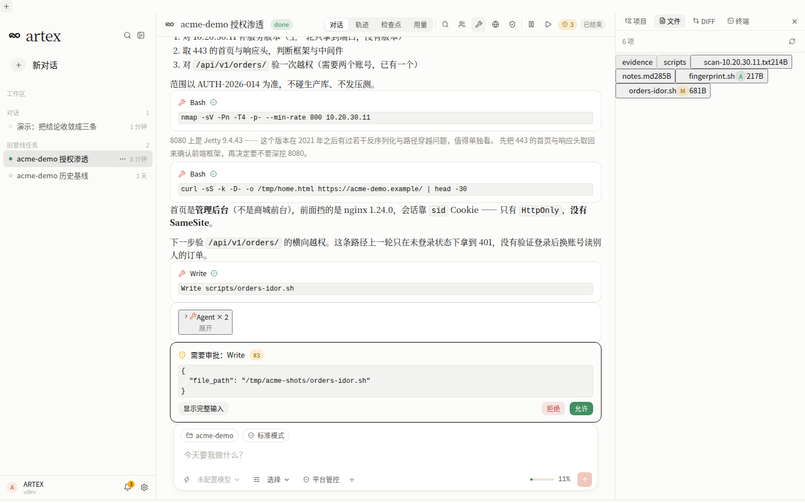

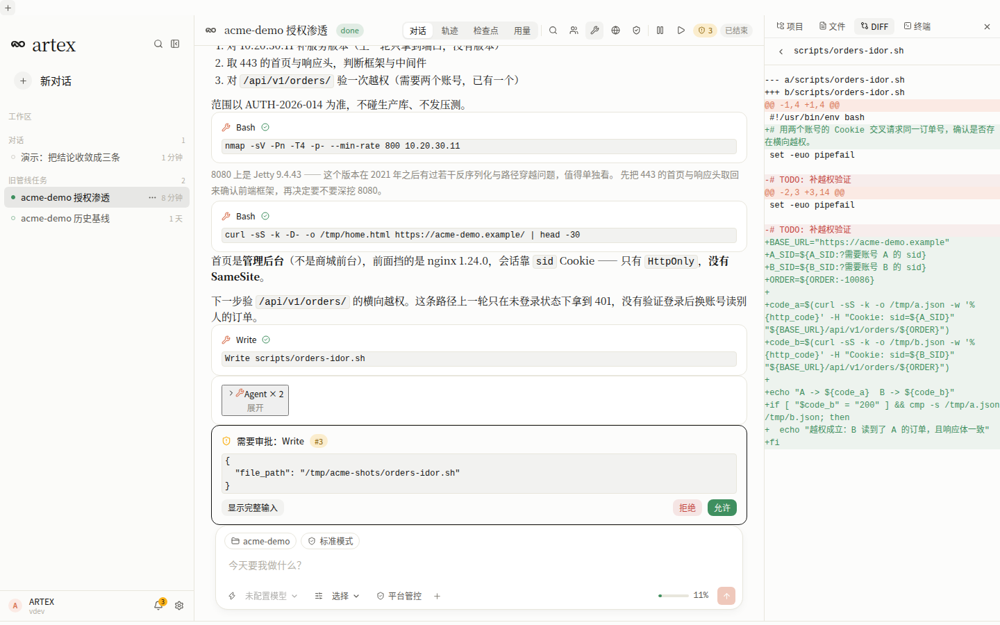

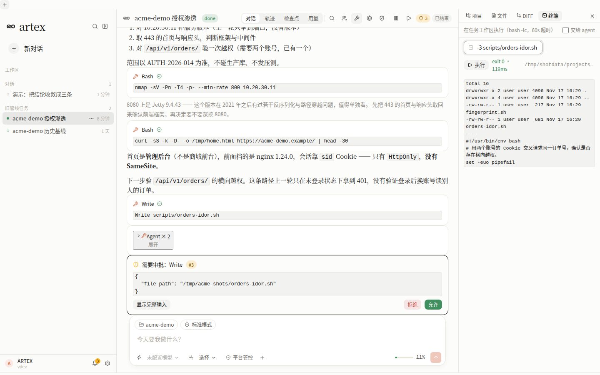

> 终端那一张里，`human.sh` 那一行就是"人接管执行一步"的留痕：命令与输出都写进 activity，
> 所以回放与事件流里能区分"agent 做的"和"人做的"。

### 6.2 子代理 / 浏览器 / 系统

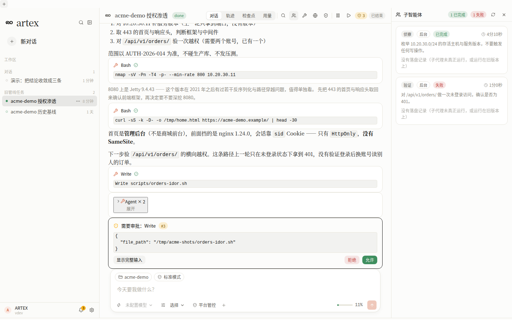

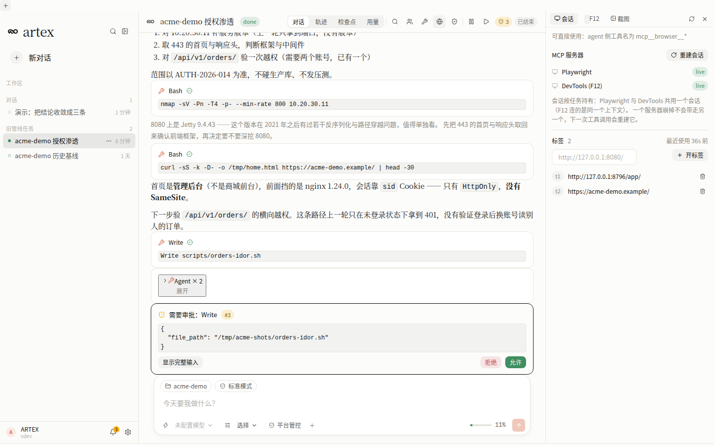

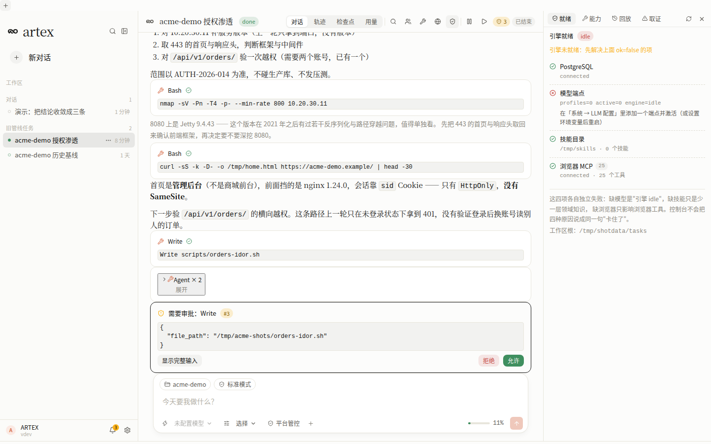

### 6.3 用量与命令面板

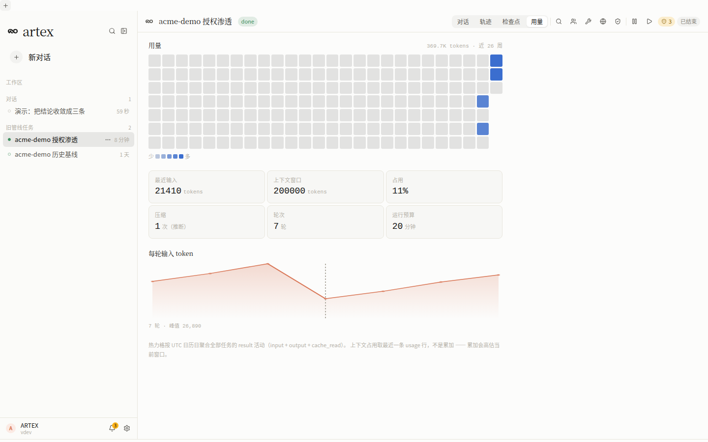

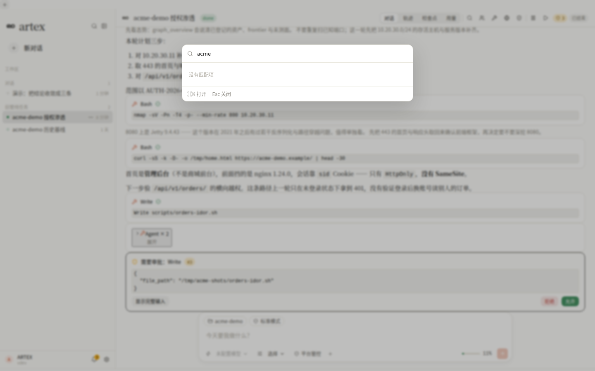

> 「压缩」卡显示 `1 次（推断）`：SDK 的真实压缩事件为 0，这个数是按"同一轮内输入 token
> 回落 ≥20%"推断出来的，界面把"推断"写出来，不冒充真实事件。

### 6.4 窄窗口（≤900px）

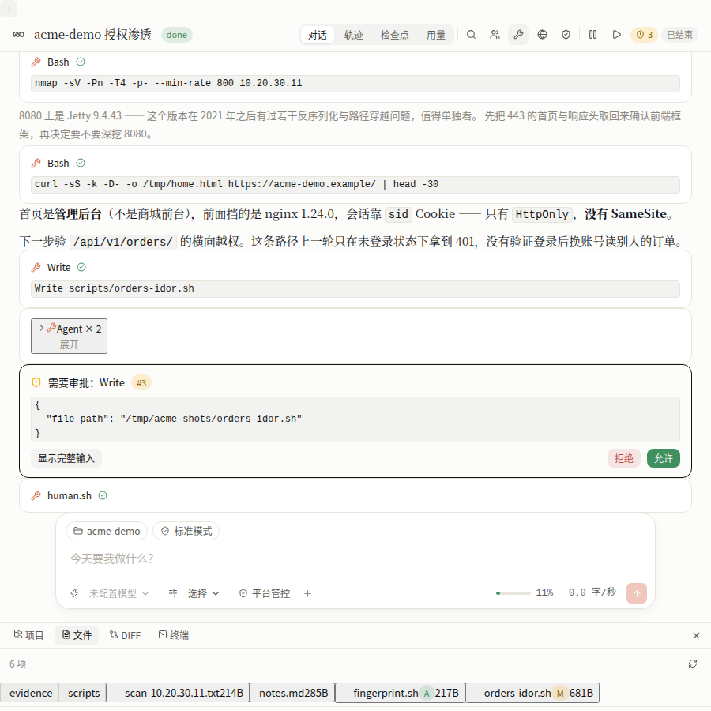

> 这条路径曾经是坏的（右栏被压成 56px 竖条，看起来像"透视倾斜"），
> 原因与修法记在 [`12-SPRINT4-WORKBENCH.md`](12-SPRINT4-WORKBENCH.md) §四之二。

这些是本仓库的**主体功能**，不是可选装饰；它们的入口与行为见 `docs/15-FEATURES.md`。